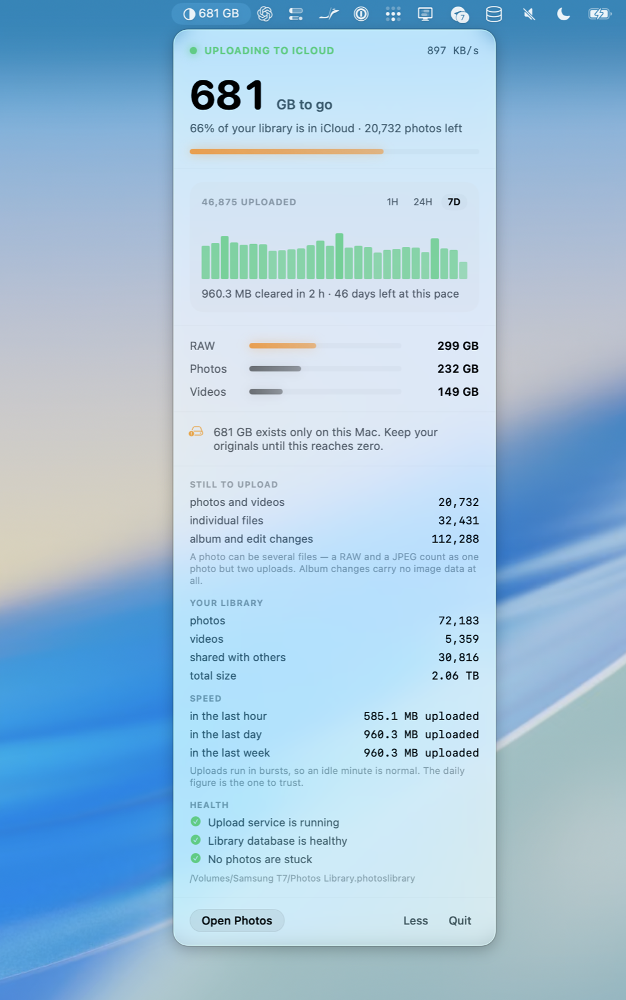

# Halo

**A macOS menu bar app that tells you how much of your photo library is actually in iCloud.**

<!-- Screenshot: drop docs/screenshots/hero.png in place, then uncomment.
<p align="center">
  
</p>
-->

<p align="center">
  <em>macOS 14+ &nbsp;·&nbsp; Swift &nbsp;·&nbsp; GPL-3.0 &nbsp;·&nbsp; read-only, always</em>
</p>

---

## The problem

Photos gives you an item count and a spinner. On a large library, neither is reliable.

The progress Photos reports comes from a flag in its own index that is set when Photos
*creates* a cloud record — not when iCloud confirms it has received the file. The two events
can be days apart. On a multi-terabyte library the gap between them reaches hundreds of
gigabytes, and Photos will happily show a nearly-finished upload the whole time.

That is fine until the one moment it isn't: when you decide it's safe to erase the drive
holding your only other copy.

Halo ignores that flag. It reads the CloudPhotos sync engine's own outgoing queue — the
actual list of work left to do — and reports from there.

## What it shows

**How much is left.** Bytes still queued, split into RAW, Photos, and Videos, plus how much
of the library is confirmed in iCloud.

**Whether it's moving.** Uploads run in bursts, so a single idle minute means nothing. Halo
only reports a stall after sustained silence, then offers the restart that actually clears
it.

**What has landed, and when.** The chart comes from the sync engine's confirmation log, so
it's populated the first time you open the app rather than starting from launch. Log scale,
because upload volume is bursty enough that a linear axis flattens every quiet period to
nothing. Hover a bar for the exact time and count.

**Whether a folder is safe to erase.** Drop an SD card, a Downloads folder, or an old
external drive onto the popover. Halo matches each file against the library by name *and*
exact byte length, checks that every match is confirmed in iCloud, and answers plainly:
safe to erase, or these files exist nowhere else.

**Details**, on request: queued photos vs. individual files vs. pending metadata changes,
library totals, upload rate over the last hour / day / week, service health, and how many
items Photos has given up on.

## Install

1. Download `Halo.app.zip` from [Releases](../../releases), unzip, and drag it to
   `/Applications`.
2. Builds are ad-hoc signed, so Gatekeeper blocks the first launch. Right-click the app and
   choose **Open**, or:
   ```sh
   xattr -dr com.apple.quarantine /Applications/Halo.app
   ```
3. Halo needs to read your Photos library. Either grant **Full Disk Access** under System
   Settings → Privacy & Security, or click **Choose Library…** and point it at your
   `.photoslibrary`. Prefer the second: it stores a security-scoped bookmark, which survives
   app updates. A Full Disk Access grant does not, because an ad-hoc signature changes on
   every build.

Requires macOS 14 or later. On macOS 26 the interface uses Liquid Glass; below that it falls
back to a standard material.

## What it touches

Halo **only ever reads.** It never moves, edits, or deletes anything in your library, and
every database is opened read-only.

Two buttons act on the system, and only ever on Photos itself — never on your files:

| Button | What it runs |
|---|---|
| Restart backup | Scripts Photos' own Pause → Resume, which restarts the sync session as user-initiated rather than discretionary background work |
| Restart backup service | `launchctl kickstart -k gui/<uid>/com.apple.cloudphotod` |

---

## How it works

A Photos library contains two databases that routinely disagree:

| File | What it is |
|---|---|
| `database/Photos.sqlite` | The library index — what the Photos app displays. Its `ZREMOTEAVAILABILITY` flag is optimistic. |
| `resources/cpl/cloudsync.noindex/storage/store.cloudphotodb` | The CloudPhotos sync engine's state. `outgoingResources` is the real work queue; `idMapping.addTimestamp` records when each item was confirmed. |

Halo reads the second for anything about sync, and the first only for library totals and
folder verification.

Three constraints shape the code, all learned the hard way:

- **`mode=ro`, never `immutable=1`.** `immutable` tells SQLite to ignore the write-ahead
  log, which makes a perfectly healthy live database report as malformed.
- **Reads are short and never overlap.** A held read lock stops SQLite checkpointing the
  WAL. Let readers pile up and the WAL grows without bound — at which point the monitor has
  become the thing slowing down the sync it is watching. `Monitor` guards this with a
  re-entrancy flag.
- **Nothing expensive on the poll path.** `PRAGMA quick_check` on a multi-gigabyte library
  takes minutes and holds a lock the whole time. It's available on demand, never on a timer.

### Project layout

```
Sources/Halo/
  HaloApp.swift       MenuBarExtra scene; the status item is the product
  Model.swift         Monitor (polling, phase detection, actions), Snapshot, formatting
  LibraryReader.swift every SQLite query lives here — the only file that touches Apple's schema
  History.swift       on-disk queue-size time series with a retention ladder
  Chart.swift         upload bars and the queue area chart
  PopoverView.swift   the entire interface
Resources/Info.plist  LSUIElement — that's the whole bundle requirement for a menu bar app
build.sh              wraps the SPM binary in an .app and ad-hoc signs it
```

### Build

```sh
git clone https://github.com/<owner>/halo.git && cd halo
./build.sh release        # produces build/Halo.app
open build/Halo.app
```

There's no Xcode project — it's a Swift Package plus a script.

## Contributing

Issues and pull requests are welcome — see [CONTRIBUTING.md](CONTRIBUTING.md). The short
version: keep it read-only, keep expensive work off the poll path, and agree to the
[CLA](CLA.md) on your first pull request.

Schema breakage is the main maintenance burden. These are private Apple databases that
change without notice, so a query that stops working on a new macOS release is a genuinely
useful issue.

Open on the roadmap:

- Notifications — stalled for more than 30 minutes, upload complete, storage nearly full
- Launch at login
- Developer ID signing and notarisation, so permission grants survive updates
- Verified on macOS 14 and 15 (developed on 26)

## Caveats

- Private Apple schema. It can change without notice, and when it does Halo needs updating.
- Ad-hoc signed, not notarised.
- Not affiliated with or endorsed by Apple.

## License

[GNU General Public License v3.0 or later](LICENSE).

Use it for anything, including at work. If you distribute a modified version, that version
must be GPL too and ship with its source — so Halo cannot be forked into a closed-source
product or sold on the App Store by anyone else.

Contributions are covered by a [CLA](CLA.md), which lets the project also be offered under
other terms. For a commercial licence, open an issue.
